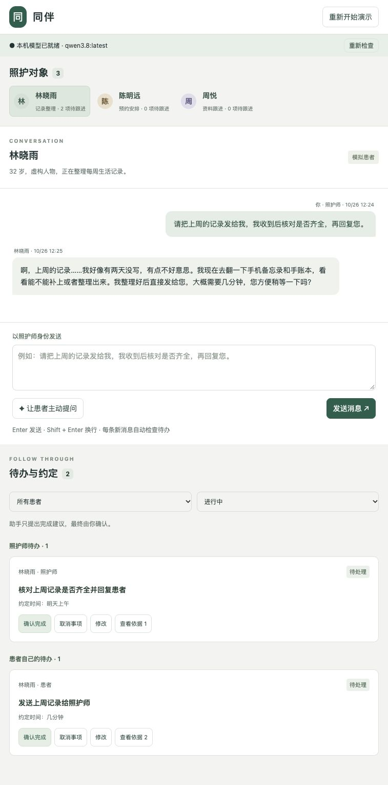

# 同伴 · 共同照护待办助手

一个在自己电脑上运行的共同照护 Demo。你扮演照护师，AI 扮演患者；旁边的待办观察员会阅读双方对话，整理需要跟进的事情，并在发现完成线索时请你确认。

本指南面向几乎没有 Python 基础的同学。从安装软件开始，按顺序操作即可，不需要自己写代码。

**运行成功后，你应该能做到：发送一句照护师消息，看到患者回复和待办变化，再亲手确认一项待办完成。**



## 阅读路线

第一次使用，先选择运行方式：

- **本地模型**：第 1～12 节按默认 Ollama 方案说明。依次完成第 1～6 节即可开始，已经运行过可直接看第 8 节。
- **云端 API**：电脑内存不足、运行太慢或无法安装 Ollama 时，先做第 2 节和第 4 节，再阅读[云端接入教程](docs/CLOUD_API.md)。可选 DeepSeek、GLM 或 Qwen 官方服务，不用安装 Ollama。

当前代码默认使用本地模型。云端教程包含需要新增和修改的代码，完成这些修改后才可切换。

- [1. 开始前需要准备什么](#step-1)
- [2. 安装 Python](#step-2)
- [3. 安装 Ollama 并下载模型](#step-3)
- [4. 下载项目，准备运行环境](#step-4)
- [5. 启动网页](#step-5)
- [6. 完成第一次操作](#step-6)
- [7. 可以照着输入的调试案例](#step-7)
- [8. 关闭与再次启动](#step-8)
- [9. 出错时怎样排查](#step-9)
- [10. 数据保存与重新演示](#step-10)
- [11. 可选：运行项目自带的检查](#step-11)
- [12. 想进一步了解项目](#step-12)
- [13. 可选：改用官方云端 API](#step-13)

<a id="step-1"></a>
## 1. 开始前需要准备什么

### 这几个东西分别是做什么的？

| 名称 | 可以怎样理解 | 本项目怎么用 |
| --- | --- | --- |
| Python 解释器 | 让电脑执行 Python 程序的软件 | 启动网页服务、保存聊天和待办 |
| Ollama | 在自己电脑上运行大语言模型的软件 | 提供本机模型服务 |
| `qwen3.8:latest` | Ollama 要加载的具体模型 | 分别扮演患者和待办观察员 |
| 项目文件夹 | 已经写好的程序及页面 | 本 README 与 `app.py` 就在里面 |
| 浏览器 | 打开操作界面 | 聊天、查看待办、确认完成 |

**安装 Ollama 和下载模型是两件事。** 只安装 Ollama，还不能让这个 Demo 回答问题。

默认本地方案不需要购买云端 API、不需要 API Key，也不需要安装第三方 Python 库。按此方案运行不需要 Anaconda、Node.js 或代码编辑器。第 13 节的云端方案需要对应平台的 API Key 和可用额度。

### 电脑和网络

- 使用笔记本或台式机。下面分别给出 macOS 和 Windows 的操作，只做与你的系统对应的部分。
- 当前 Ollama 官方要求 macOS 14 或更新版本，或 Windows 10 22H2 或更新版本。具体兼容情况以 [macOS 说明](https://docs.ollama.com/macos)和 [Windows 说明](https://docs.ollama.com/windows)为准。
- 初次安装软件、下载项目和模型需要网络。下载完成后，Demo 的模型调用在本机进行。
- 模型比较大：项目此前验证的本地版本约 **17 GB、27B 参数**，目前[官方模型页面](https://ollama.com/library/qwen3.8)显示的下载大小可能不同。建议先预留约 **40 GB 可用磁盘空间**，这是安装准备建议，不是运行内存要求。
- 模型运行还需要额外内存。8 GB 或 16 GB 内存的电脑不要默认它能流畅运行；先完成第 3 节的模型试运行。如果明显卡顿或提示内存不足，可以使用教师的演示电脑，或按第 13 节改用云端 API。只有 CPU 并不等于不能运行 Ollama，主要取决于模型大小、可用内存和能否接受等待。

这里只使用三位虚构患者，演示资料、记录和日程沟通。请勿输入真实患者隐私，不用于诊断或用药决策。

### 先认识“终端”

终端是一个可以输入命令的窗口。

- **macOS**：按 `Command + 空格`，搜索“终端”，回车打开。
- **Windows**：在开始菜单搜索“PowerShell”，打开即可，不需要管理员身份。

后面的灰色命令框可以复制。**一次执行一行，每行后按回车。** 不要复制说明文字或代码框边界，也不要自己加上 `$`、`>>>` 等符号。

有的命令成功后没有文字输出，只是出现新的输入位置，这通常是正常的。

<a id="step-2"></a>
## 2. 安装 Python

项目要求 **Python 3.10 或更新版本**，已有验收记录使用的是 Python 3.13.5。

### macOS

1. 打开 [Python 官方 macOS 下载页](https://www.python.org/downloads/macos/)。
2. 选择受支持的正式版本，下载 **macOS 64-bit universal2 installer**，不要选择源代码包或测试版。
3. 双击下载的 `.pkg` 文件，按安装向导完成安装。可以保留默认选项。
4. 关闭旧的终端窗口，重新打开终端，输入：

   ```bash
   python3 --version
   ```

看到 `Python 3.13.x`、`Python 3.14.x` 等版本号即可，实际版本不必与示例完全一致，但必须是 3.10 或更新版本。如果你原来已经安装了符合要求的版本，可以跳过安装。

安装方式参考 [Python 官方 macOS 指南](https://docs.python.org/3/using/mac.html)。

### Windows

如果已经有 Python，可先输入 `python --version`。显示 3.10 或更新版本时，可以直接进入下一节。

从未安装过时：

1. 打开 [Python 官方下载页](https://www.python.org/downloads/)，下载并安装 **Python install manager**，也可按该页面指引从 Microsoft Store 安装。
2. 重新打开 PowerShell，依次输入下面两行。这里选用 3.13 系列：

   ```powershell
   py install 3.13
   py -3.13 --version
   ```

3. 第二行应显示 `Python 3.13.x`。

如果 `py install` 提示找不到 `install` 文件，可能调用到了旧版 Python 启动器。确认安装了上述 install manager 后，将第一行改为 `pymanager install 3.13`。

Windows 的安装方式会随版本更新，详情见 [Python 官方 Windows 指南](https://docs.python.org/3/using/windows.html)。不用为了本项目卸载已有的 Python。

<a id="step-3"></a>
## 3. 安装 Ollama 并下载模型

### 3.1 安装 Ollama

打开 [Ollama 官方下载页](https://ollama.com/download)，选择自己的操作系统。

- **macOS**：打开下载的安装文件，将 Ollama 拖入“应用程序”，然后打开 Ollama。如果提示安装命令行工具，按应用指引完成。
- **Windows**：运行下载的 `OllamaSetup.exe`，按提示完成安装，然后打开 Ollama。

重新打开终端或 PowerShell，输入：

```bash
ollama --version
```

能显示版本号，说明已经能找到 Ollama 命令。打开 Ollama 应用并保持它运行，模型服务通常会随应用启动。

如果后续提示无法连接 Ollama，可先重新打开应用。也可以在**另一个终端窗口**输入：

```bash
ollama serve
```

这个窗口需要保持打开。如果提示 `address already in use`，通常表示 Ollama 已在运行，不要重复启动。

### 3.2 下载指定模型

在可以继续输入命令的终端窗口运行：

```bash
ollama pull qwen3.8:latest
```

第一次需要下载较大的模型文件，请保持联网并等待结束。速度取决于网络，不能按普通小软件的安装时间估计。

完成后输入：

```bash
ollama list
```

在列表的 `NAME` 一栏找到完整名称：

```text
qwen3.8:latest
```

**模型名称必须完全一致。** 当前程序固定使用这个名称，不会自动换成其他模型，也不会自动下载缺失模型。`latest` 标签可能更新，因此你看到的模型 ID、文件大小不一定与教师电脑相同。已经有该模型时，不必每次启动都重新下载。

下载命令参考 [Ollama 官方命令说明](https://docs.ollama.com/cli)。

### 3.3 先单独试一下模型

输入：

```bash
ollama run qwen3.8:latest "请用一句中文说明你已经可以回答问题。"
```

第一次加载可能较慢。只要能得到一段正常回复，并回到命令输入位置，就说明这台电脑上的模型能够生成内容。回复文字不需要完全一致。

如果这里已经出现内存不足、版本过旧或无法连接，先按第 9 节处理，再继续启动项目。**模型能在这里回答，不代表待办判断一定正确；后面还需要试完整流程。**

<a id="step-4"></a>
## 4. 下载项目，准备运行环境

### 4.1 获得完整项目文件夹

如果从 GitHub 获取：

1. 打开教师提供的项目仓库页面。
2. 点击绿色 **Code** 按钮，再点 **Download ZIP**。
3. 解压下载的 ZIP。Windows 请先选择“全部解压缩”，不要在压缩包预览里直接运行。
4. 逐层打开解压后的文件夹，找到同时包含 **`app.py`、`core.py`、`static` 和 `README.md`** 的文件夹。这才是下面说的“项目文件夹”。仓库外层可能还有课件，不一定就是项目目录。

如果教师已经给了完整的 `care-todo` 文件夹，直接使用即可。不要只下载 `app.py`，它还需要其他文件。

### 4.2 让终端进入项目文件夹

**macOS：** 在终端输入 `cd`，再按一次空格；从 Finder 把项目文件夹拖入终端，按回车。随后输入：

```bash
pwd
ls app.py
```

第一行显示当前文件夹，第二行应能显示 `app.py`。

**Windows：** 在文件资源管理器中打开项目文件夹，点击上方地址栏，输入 `powershell`，按回车。在新开的窗口里输入：

```powershell
Get-Location
Get-ChildItem app.py
```

应能看到当前文件夹的位置和 `app.py`。若找不到文件，返回文件管理器，确认没有停在项目的上一级。

### 4.3 创建这个项目自己的 Python 环境

可以把“虚拟环境”理解成项目专用的 Python 文件夹，通常命名为 `.venv`。只需要创建一次。下面直接指定其中的 Python 来运行，**不需要另外激活环境或修改 PowerShell 的执行权限**。

macOS 输入：

```bash
python3 -m venv .venv
./.venv/bin/python --version
```

Windows 如果按第 2 节安装了 Python 3.13，输入：

```powershell
py -3.13 -m venv .venv
.\.venv\Scripts\python.exe --version
```

如果 Windows 原本已有可用的 Python，第一行也可以使用 `python -m venv .venv`。

第二行能显示 Python 版本号，就完成了环境准备。`.venv` 在 macOS Finder 中可能默认隐藏，这不影响使用。

**接下来不用执行 `pip install`。** 项目只用 Python 自带的功能，没有需要安装的第三方库，也没有 `requirements.txt`。不用单独安装 SQLite 或 Ollama 的 Python 包。

这种直接使用虚拟环境解释器的方式见 [Python 官方 venv 说明](https://docs.python.org/3/library/venv.html)。如果后来移动了整个项目文件夹，建议在新位置重新创建 `.venv`，不要把旧环境当成可移植文件。

<a id="step-5"></a>
## 5. 启动网页

确认 Ollama 仍在运行，并且终端仍位于项目文件夹。

macOS：

```bash
./.venv/bin/python app.py --open
```

Windows PowerShell：

```powershell
.\.venv\Scripts\python.exe app.py --open
```

终端会显示类似下面的信息，浏览器会自动打开：

```text
共同照护待办助手：http://127.0.0.1:8765
数据保存在：……/care-todo/data
仅虚构资料演示。按 Ctrl+C 停止。
```

如果浏览器没有自动打开，手动在浏览器地址栏输入：

**[http://127.0.0.1:8765](http://127.0.0.1:8765)**

`127.0.0.1` 的意思是“这台电脑自己”。两个地址的用途不同：

| 地址 | 用途 |
| --- | --- |
| `http://127.0.0.1:8765` | 你要操作的共同照护网页 |
| `http://127.0.0.1:11434` | 程序背后调用的 Ollama 模型服务 |

不要直接双击 `static/index.html`，也不要把 11434 当成 Demo 网页地址。

启动后，**保留这个终端窗口**。它暂时不能继续输入普通命令，是因为正在运行网页服务。如果还需要输入其他命令，另开一个终端。

页面顶部应显示“**本机模型已就绪 · qwen3.8:latest**”。这表示程序找到了本机模型；完成下一节的一轮对话，才算完整流程已跑通。

<a id="step-6"></a>
## 6. 完成第一次操作

1. 左侧选择 **林晓雨**。
2. 将右侧患者筛选切换为 **当前患者**，状态保留 **进行中**，便于观察。
3. 在“以照护师身份发送”的输入框中粘贴：

   ```text
   请把上周的记录发给我，我收到后核对是否齐全，再回复您。
   ```

4. 点击“发送消息”，等待“正在处理”结束。
5. 查看聊天中的患者回复，以及右侧的“照护师待办”和“患者自己的待办”。
6. 点击一条待办的标题或“查看依据”，核对它引用了哪句话。

重点观察两件事：**患者需要发送记录，照护师需要核对并回复。** 患者模拟会自由回答，也可能提出其他问题，所以不要只按待办总数判断是否成功。

正常一轮聊天会依次经历：

```text
保存你的消息
待办观察员检查你的消息
模拟患者生成回复
待办观察员检查患者回复
网页显示最新结果
```

这一轮通常需要 **3 次模型调用**。本地大模型需要等待，第一次尤其慢。历史验收中，单次提取曾花费约 15～38 秒，这只是当时设备的一次记录，不是速度保证。页面仍在处理时，不要反复发送同一句话。

输入框中 `Enter` 发送，`Shift + Enter` 换行。所有手动输入都属于照护师；患者由模型扮演。

<a id="step-7"></a>
## 7. 可以照着输入的调试案例

这里的“调试”就是：**给它一个例子，观察结果是否符合预期。** 不需要改代码。

下面灰色框里的话都由你以照护师身份输入。每次等待本轮处理结束，再输入下一句。待办标题不必逐字相同，重点核对责任人、事情内容、时间和状态。

患者回复具有变化性，也可能带来新的待办。发现结果与预期不同，先点“查看依据”，区分它依据的是你的话，还是患者随后说的话。下面是检查目标，不代表模型对每种说法都一定判断正确。

### 案例 A：从新增事项到人工确认

选择林晓雨，从第 6 节的第一句继续。还没发送过时，先发送那一句。

**第 1 步：约定时间，同时再次提到同一件事。**

```text
我明天下午会核对您上周的记录，核对后把结果回复给您。
```

预期：已有的照护师“核对记录并回复”事项更新约定时间为“明天下午”，不会因为换了一种说法就重复记一条。“会核对”是承诺，不能算已经完成。

**第 2 步：只完成其中一部分。**

```text
我已经核对完上周的记录，但还没有把核对结果回复给您，稍后再回复。
```

预期：照护师事项仍未完成，提示剩余工作是回复核对结果。不要因为看到“已经核对”就把整件事完成。

**第 3 步：出现完成线索。**

```text
收到了，已经核对，记录都齐全。现在把核对结果告诉您：上周的记录完整，没有缺项。
```

预期：照护师的核对并回复事项出现“可能完成，等你确认”，引用这句对话。**没有点击按钮前，不应自动变成“已完成”。**

**第 4 步：由你作决定。**

- 点击“查看依据”，核对原话。
- 如果认为没有做完，点击“还没完成”，应回到待处理。
- 如果确认做完，点击“确认完成”，再将右侧状态筛选改为“已完成”，应能找到这条事项。

“确认完成”是一个人工操作按钮，不是需要输入聊天框的口令。

### 案例 B：后文推翻之前的完成说法

接案例 A。如果之前已经人工确认了照护师事项，输入：

```text
更正一下，我刚才核对的是前一周的记录，不是上周的。上周的记录还没有核对。
```

预期：提示“后续说法有矛盾，请核实”。对**已经人工确认完成**的事项，程序保留完成状态，等待你核实并点击“重新打开”；这条核实提醒也会出现在“进行中”视图。模型不能悄悄撤销你的人工确认。

### 案例 C：普通回应不应凭空变成任务

在一段已有对话后输入：

```text
好的，谢谢。
```

预期：这句话本身不建立“感谢患者”之类的待办，也不能证明旧事项已经完成。如果患者随后主动提出一个新的明确请求，出现对应新待办是合理的，要看原话判断。

### 案例 D：不同患者的事情必须分开

切换到 **陈明远**，输入：

```text
我明天帮您确认预约时间，确认后告诉您。
```

等待结束后，切换到 **周悦**，输入：

```text
我明天把记录模板发给您。
```

预期：两项照护师待办分别属于陈明远和周悦。“当前患者”只显示所选患者的事项；切换为“所有患者”，可以一起查看。不能把两人的消息或事项合并。

### 案例 E：患者主动提问

选择一位患者，点击 **“让患者主动提问”**，不要在聊天框中冒充患者。

预期：模型生成一条患者消息，观察员随后检查它。如果含有明确请求，形成相应待办；如果没有明确任务，也可以不新增。这个按钮每次触发一次，不会让患者在后台无限说话。

### 案例 F：人工修改与数据保留

选一项待处理事项，等消息处理结束后：

1. 点击“修改”，修改约定时间并保存。
2. 刷新网页，查看修改是否仍在。
3. 点击“取消事项”，再将状态筛选改为“已取消”，应能找到原记录。
4. 点击“重新打开”，应回到待处理。

取消会保留历史，当前没有永久删除单条待办的按钮。程序还会保护你手动改过的标题和时间，避免模型随后覆盖它们。

如果想逐句复现产品说明书中患者说“好的，我明天发”“我已经发过去了”的固定例子，请看第 11 节的真实模型检查脚本。**不要把患者台词粘贴到照护师输入框**，否则说话者就变了。

<a id="step-8"></a>
## 8. 关闭与再次启动

### 关闭

回到运行 `app.py` 的终端，按 **`Ctrl + C`**。macOS 也使用 Control 键，不是 Command 键。

只关闭浏览器标签页不会停止程序。停止程序也不会自动清除聊天和待办。若正在处理时退出，下次启动会保留已完成步骤，并将中断步骤标记为可重试。

### 下次启动

不用重新安装软件、下载模型或创建环境。只需要：

1. 打开 Ollama。
2. 打开终端并进入项目文件夹，方法见第 4.2 节。
3. 执行对应命令。

macOS：

```bash
./.venv/bin/python app.py --open
```

Windows：

```powershell
.\.venv\Scripts\python.exe app.py --open
```

项目还提供 macOS 的 `start.command` 和 Windows 的 `start.bat` 双击启动器。它们使用系统中的 `python3` / `python`，**不会自动创建或使用这里的 `.venv`**。第一次运行建议按上述命令操作，方便看到报错。

<a id="step-9"></a>
## 9. 出错时怎样排查

### 9.1 按三个层次检查

1. **Python 能否运行？** 输入第 4.3 节的环境版本检查命令。
2. **模型能否回答？** 输入第 3.3 节的 `ollama run` 命令。
3. **网页能否完成一轮对话？** 启动 `app.py`，执行第 6 节的例子。

这样可以区分是 Python、Ollama，还是待办处理出了问题。

### 9.2 常见现象

| 看到的现象 | 可以怎么处理 |
| --- | --- |
| `python3`、`python` 或 `py` 找不到 | 确认 Python 已安装，关闭旧终端再打开。Windows 按第 2 节使用 install manager 安装并检查版本 |
| Python 安装后，输入命令跳到商店 | 先确认已安装 Python install manager 和解释器；可用 `py -3.13 --version` 检查，再使用本文创建环境的方法 |
| `.venv` 中的 Python 找不到 | 确认当前目录是项目文件夹，并完成第 4.3 节。环境移动或原 Python 被卸载时，需重新创建环境 |
| 提示 `can't open file ... app.py` 或找不到文件 | 终端没有进入正确项目目录。回到第 4.2 节，检查能否列出 `app.py` |
| `ollama` 找不到 | 确认安装并打开过 Ollama，重开终端。macOS 按应用提示安装命令行工具 |
| `pull` 下载失败、网络超时 | 检查网络和磁盘空间，再执行同一条下载命令。如果提示模型不存在，核对拼写和官方模型页面，不要随意改成其他模型名 |
| 提示需要更新版本的 Ollama | 从官网下载更新，重新打开 Ollama，再运行模型试验 |
| 提示无法连接 Ollama | 打开 Ollama 应用，必要时在另一个窗口运行 `ollama serve`。回网页点击“重新检查” |
| `ollama serve` 提示 11434 已占用 | 可能已经有 Ollama 在运行。先用 `ollama list` 检查，不要急着关闭已有进程 |
| 页面说没有 `qwen3.8:latest` | 执行 `ollama list` 核对完整名称，缺失时执行第 3.2 节的下载命令。模型下载在别的电脑上不算本机已安装 |
| 页面说模型指向云端 | 本项目只接受本地模型。按第 3 节下载指定本地模型，不使用带云端转发的别名 |
| 网页打不开，或说无法连接小程序 | 确认运行 `app.py` 的终端仍然开着、没有退出，网址是 `http://127.0.0.1:8765` |
| 待办突然“消失” | 检查“当前患者 / 所有患者”和状态筛选。确认完成后，事项会离开普通的进行中列表 |
| 发送或修改按钮暂时不可用 | 等当前患者处理结束。若显示失败，先点击“重试失败步骤”；同一患者存在未处理失败步骤时不能继续发送 |
| 出现 `JSON`、待办字段或消息依据错误 | 模型给出的结果不符合程序要求，本轮变化未保存。点击“重试失败步骤”；反复失败时记录错误和对应对话，交给教师排查 |
| 模型很慢、超时或内存不足 | 先结束其他占用内存的软件，再试第 3.3 节。程序单次模型请求超时为 240 秒，一轮聊天有多次请求。重复失败时改用能运行该模型的演示电脑 |
| 提示页面会话已失效 | 程序可能刚重启过。刷新网页，再继续操作 |
| 提示已有程序使用这个数据目录 | 回到先前打开的网页或终端。需要重启时，在旧终端按 `Ctrl + C`，不要靠删除 `app.lock` 解决 |
| 提示对话超过上下文限制 | 先备份数据，再重新开始演示，或使用下一节的独立数据目录。程序不会偷偷丢掉前文继续判断 |

### 9.3 网页的 8765 端口被占用

如果已经有本项目在运行，先使用原来的网页即可。确认需要改用另一个端口时，在项目目录执行：

macOS：

```bash
./.venv/bin/python app.py --port 8766 --open
```

Windows：

```powershell
.\.venv\Scripts\python.exe app.py --port 8766 --open
```

这次网页地址是 `http://127.0.0.1:8766`，Ollama 仍然使用 11434。更换网页端口不会解除“同一数据目录只能运行一个程序”的限制。

### 9.4 失败之后怎样继续

页面顶部的“**重新检查**”只检查模型是否就绪。它**不会**重新处理失败消息。

先解决连接或模型问题，再点击聊天区域的“**重试失败步骤**”。例如患者已回复、但后面的待办提取失败，重试会从提取步骤继续，不会再生成一遍已保存的患者回复。不要为了重试而反复发送同一句话。

需要帮助时，提供：操作系统、Python 版本、Ollama 版本、`ollama list` 的结果、失败步骤和完整错误文字。对话只使用虚构内容即可。

<a id="step-10"></a>
## 10. 数据保存与重新演示

聊天、待办及操作记录默认保存在项目里的 **`data/care.sqlite3`**。程序会自动创建它，不需要手动安装或初始化数据库。

- 刷新网页、切换患者或正常重启，不会清空已保存内容。
- 备份：先停止程序，再复制整个 `data` 文件夹。
- 恢复：先停止程序，保留当前数据的备份，再用需要恢复的 `data` 文件夹替换，重新启动。
- 清空演示：点击右上角“重新开始演示”，确认后会清除**三位患者的全部演示记录**。处理中不能清空。
- 分享项目或上传 GitHub 时，不要包含自己的 `data` 和 `.venv` 文件夹。模型文件由 Ollama 单独管理，不在项目文件夹里。

如果想试一组全新的例子，同时保留原来的演示，可以使用另一份数据目录：

macOS：

```bash
./.venv/bin/python app.py --port 8766 --data-dir ./another-demo --open
```

Windows：

```powershell
.\.venv\Scripts\python.exe app.py --port 8766 --data-dir ./another-demo --open
```

新数据会自动保存在 `another-demo` 文件夹中。返回第 5 节的普通启动命令，就会再次使用原来的 `data`。使用新目录启动时，同样要等待模型准备就绪。

<a id="step-11"></a>
## 11. 可选：运行项目自带的检查

完成网页体验后再看这一节。测试命令也在项目文件夹中执行，使用另一个终端，或先按 `Ctrl + C` 停止网页服务。

### 11.1 检查程序规则，不需要 Ollama

macOS：

```bash
./.venv/bin/python -m unittest discover -s tests -v
```

Windows：

```powershell
.\.venv\Scripts\python.exe -m unittest discover -s tests -v
```

成功时末尾显示 `OK`。这些测试检查保存、状态变化、失败重试等程序规则，使用可控的模拟结果，**不证明真实模型理解所有对话都正确**。

### 11.2 让真实模型检查一段固定对话

以下按默认本地方案说明。若已按第 13 节修改代码并设置云端平台，同一脚本会改为调用云端 API，可能计费，具体步骤见[云端教程](docs/CLOUD_API.md)。

先确认 Ollama 和指定模型可用，避免同时在网页中提交其他消息。

macOS：

```bash
./.venv/bin/python -u tests/live_acceptance.py
```

Windows：

```powershell
.\.venv\Scripts\python.exe -u tests/live_acceptance.py
```

脚本会自动按正确的说话者输入以下对话，不需要你手动复制：

| 顺序 | 谁说的 | 内容 | 预期 |
| --- | --- | --- | --- |
| 1 | 照护师 | 请把上周的记录发给我，我收到后核对是否齐全，再回复您。 | 建立患者发送、照护师核对并回复两项待办 |
| 2 | 患者 | 好的，我明天发。 | 更新约定时间，不算完成 |
| 3 | 患者 | 我已经发过去了。 | 患者发送事项可能完成，照护师核对事项仍待处理 |
| 4 | 照护师 | 收到了，已经核对，记录都齐全。 | 照护师事项可能完成，仍需人工确认 |

随后脚本会模拟人工确认，并检查患者主动提问、自动回复和不同患者的事项隔离。完整通过时，最后会看到这三类 `PASS` 提示：

```text
PASS: 产品文档四句对话与人工确认完成。
PASS: 患者主动提问与自动观察
PASS: 照护师发送、患者自动回复、双方消息检查、患者隔离。
```

脚本使用临时数据库，不改动网页里的演示数据，脚本对话也不会出现在现有网页中。它会实际调用本地模型，可能耗时数分钟。如果出现 `AssertionError`，表示本次结果没有达到脚本预期，需要结合前面的输出排查，不能把它当作成功。

既往验收结果和验证边界见 [TEST_REPORT.md](TEST_REPORT.md)。原有完整验收在 macOS 上进行，Windows/Linux 启动方式未作实机验收；更多自由对话的表现仍需用例子检查。

<a id="step-12"></a>
## 12. 想进一步了解项目

### 一个模型，两个角色

- **模拟患者**收到自己的角色设定和当前对话，生成患者回复。
- **待办观察员**收到当前患者已经说出的对话及已有待办，判断是否新增或更新事项。它不会提前看到患者尚未说出的隐藏设定，也不会读取其他患者的消息。

两者都使用本机 `qwen3.8:latest`，不需要下载两个模型。模型负责理解语言，Python 按固定流程检查和保存结果，照护师决定是否确认完成。当前实现没有让模型自主选择工具接口。

### 文件说明

| 文件 | 内容 |
| --- | --- |
| [PRODUCT_SPEC.md](PRODUCT_SPEC.md) | 用普通中文说明产品要解决什么问题、应该怎样工作 |
| `app.py` | 启动网页服务，接收页面操作 |
| `core.py` | 保存消息和待办，安排处理顺序、检查结果和失败重试 |
| `ollama_client.py` | 连接本机 Ollama，指定模型及等待时间 |
| `prompts.py` | 患者人设和待办观察员的要求 |
| `static/` | 网页的内容、样式和交互 |
| `tests/` | 程序测试和真实模型检查脚本 |
| [TEST_REPORT.md](TEST_REPORT.md) | 既往检查结果和未验证的部分 |
| `validation/` | 既往验收输出记录 |

这个 Demo 不接收附件，无法核实“我已经发送了”是否真实发生，只能根据对话提出完成建议。它是三位虚构患者的本机演示，没有真实患者接入、多人账号或无限长对话能力。它帮助理解智能体如何观察、判断和更新记录，实际使用时仍需要人核对。


<a id="step-13"></a>
## 13. 可选：改用官方云端 API

电脑不适合运行本地大模型时，可以保留本机网页和 Python 程序，把模型计算交给 DeepSeek、智谱 GLM 或阿里云百炼 Qwen。

完整操作见 **[云端 API 接入教程](docs/CLOUD_API.md)**，包括：

- 注册官方平台、获取 API Key，以及服务地址和模型名称对照。
- 新增 `cloud_client.py`，修改 `core.py` 的两行，并修正网页的运行方式提示。
- macOS、Windows 的环境变量设置、两次 API 试运行、启动 Demo 和切回 Ollama。
- 常见错误、JSON 输出差异，以及可直接交给 Vibe Coding 工具的修改要求。

原项目使用 Ollama 专用接口，不能只把 `BASE_URL` 换成云端地址。教程给出了可复制的完整适配代码，但当前项目文件尚未自动改成云端版。云端模式需要联网并可能计费，会发送对话和待办内容，只使用虚构资料。
